


 

  

---

## ✨ What is PhoneBridge?

**PhoneBridge lets you use the SIM cards in one Android phone from somewhere else**: another phone, an iPhone, an iPad or a computer.
Calls ring where you are, you talk with two-way audio, and your texts, recents, contacts and USSD codes come with you. All of it runs
over **your own network** (home Wi-Fi, the donor phone's hotspot, or Tailscale when you're away), not through a cloud service.

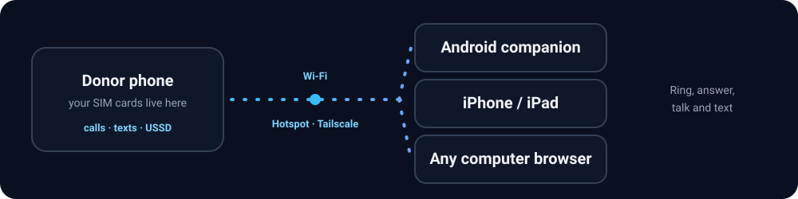

- 📱 **Donor**: the Android phone that holds the SIM cards. Leave it plugged in at home, in a drawer or on a desk.
- 📞 **Companion**: the phone, iPhone, iPad or computer you actually carry or sit at. It rings, dials and texts *through the donor's SIMs*.

---

## 🧩 What it offers

<table>
<tr>
<td width="33%" valign="top">

### 📞 Real calls
Incoming calls **ring on your companion**. Answer, decline, hold, swap with call waiting, and talk with **two-way audio** over the donor's SIM.
Hand a live call from the donor to your companion and back.

</td>
<td width="33%" valign="top">

### 💬 Texts that follow you
Read, reply, delete and mark as read, with full conversations. New messages and verification codes show up where you are.

</td>
<td width="33%" valign="top">

### 🔢 USSD codes
Check balance, buy bundles and run operator codes from the companion. A built-in safety policy refuses SIM-PIN and password changes, and
asks the donor to **Allow** call-forwarding style changes first.

</td>
</tr>
<tr>
<td valign="top">

### 🪪 Dual SIM, your way
Pick the SIM per call, choose which SIMs the companion may use, and see which SIM a call or text came in on.

</td>
<td valign="top">

### 🌐 iPhone, iPad and computers
No app needed on the other side: the donor serves a **web companion**. Scan a QR code, add it to the Home Screen, and you have calls, texts,
recents, contacts and USSD in the browser.

</td>
<td valign="top">

### 🔔 Rings even when closed
On iPhone and computers you get **call alerts** while the page is closed, and a real **ringtone** while it's open: the built-in Marimba, or
your own file.

</td>
</tr>
<tr>
<td valign="top">

### 🏡 Works at home and away
Wi-Fi, the donor's hotspot or **Tailscale**. If your network changes mid-call the connection **moves by itself** and the call carries on.

</td>
<td valign="top">

### 🔐 Private by design
Phone-to-phone traffic is encrypted and mutually authenticated. Only your account's devices can connect, one companion uses the donor at a
time, and a second one must **Take over** on purpose.

</td>
<td valign="top">

### 🎨 Two looks
**Classic** and **Liquid Glass** with wallpaper-matched palettes. The web companion follows the donor's look, or pick another one in the browser.

</td>
</tr>
</table>

<b>More details</b> (recordings, recents, contacts, widgets, saved donors)

 

- 🎙️ **Call recording** on the companion, saved to a folder you choose (when your plan includes it).
- 🕘 **Recents and contacts** with names, search and quick call or message buttons.
- 🧭 **Several donors**: save more than one donor (up to what your plan allows) and switch between them. Test a donor's bridge with one tap.
- 🧩 **Home-screen widget** and a quick-settings tile for status, missed calls and unread texts.
- 🔁 **Everything restarts by itself** after a reboot or an app update.
- 🌍 **`.local` names**: the donor answers to a permanent name on your network, so the address never changes at home.

---

## 🎯 Where it fits

<b>Pick the picture that looks like you</b>

 

| | |
|---|---|
| 🪫 **A phone that can't take a SIM** | A spare phone, an eSIM-only phone or one with no free slot: keep your number on a donor and still call and text from the phone you like. |
| ✈️ **Travelling** | Leave the home SIM on a donor with Wi-Fi, connect over Tailscale and keep receiving calls, texts and verification codes from anywhere. |
| 💻 **Working at a desk** | Answer calls and reply to texts from your laptop's browser without picking up your phone. |
| 🍎 **iPhone with an Android SIM** | Use an Android donor's SIMs from an iPhone through the web companion, with call alerts on the Home Screen. |
| 👨‍👩‍👧 **Sharing a number** | One donor, a companion for each person: take turns, or take over when it's your turn. |
| 🏢 **A SIM that stays put** | A donor on the office shelf with a data SIM or a business line, used from wherever you are. |

---

## 📸 See it

<b>On iPhone: the web companion</b>

 

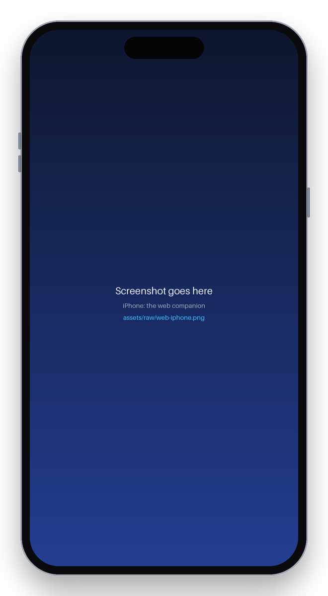
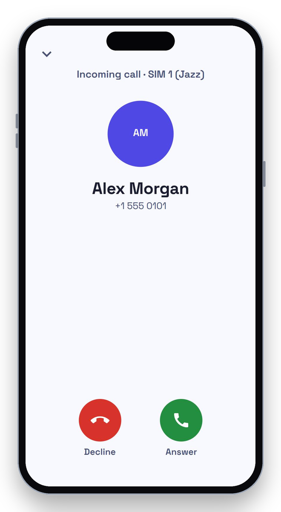
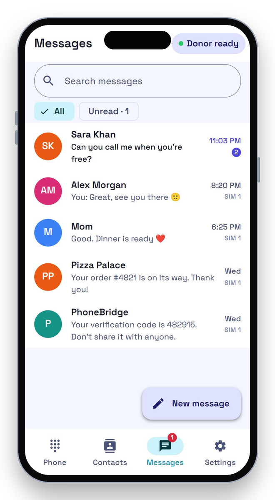
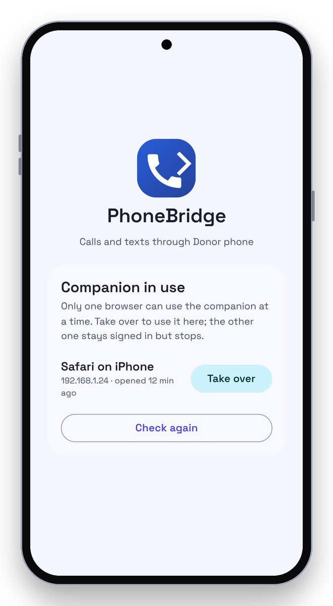

Dialer and recents · Incoming call · Messages · Take over when someone else is using it

<b>On iPad and on a computer</b>

 

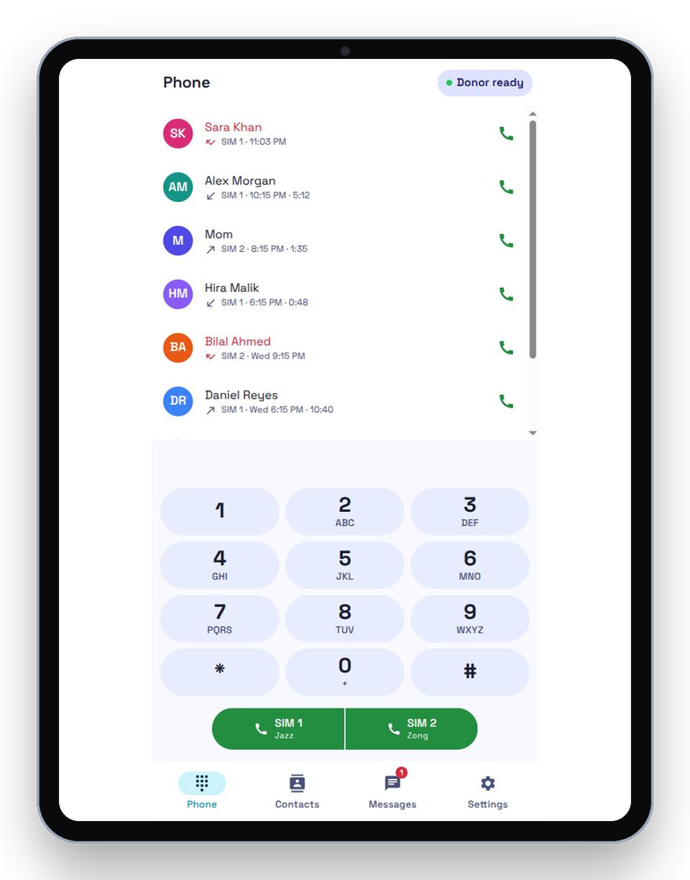
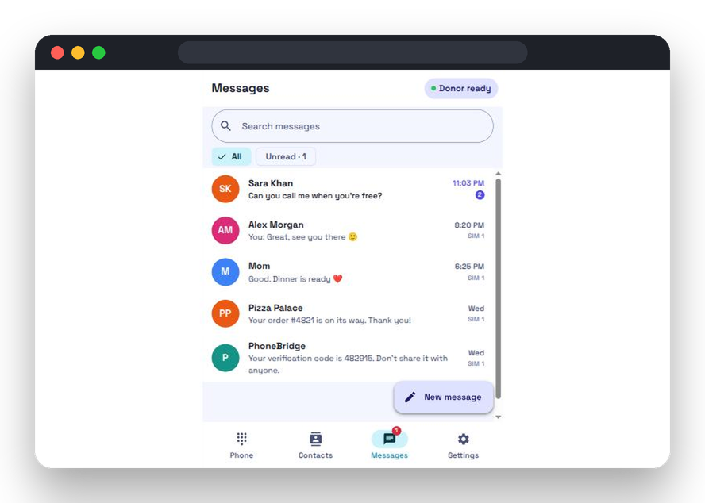

iPad · Any computer's browser

<!-- Android screenshots (add when real ones are in assets/screens/):

<b>Android donor and companion</b>

 

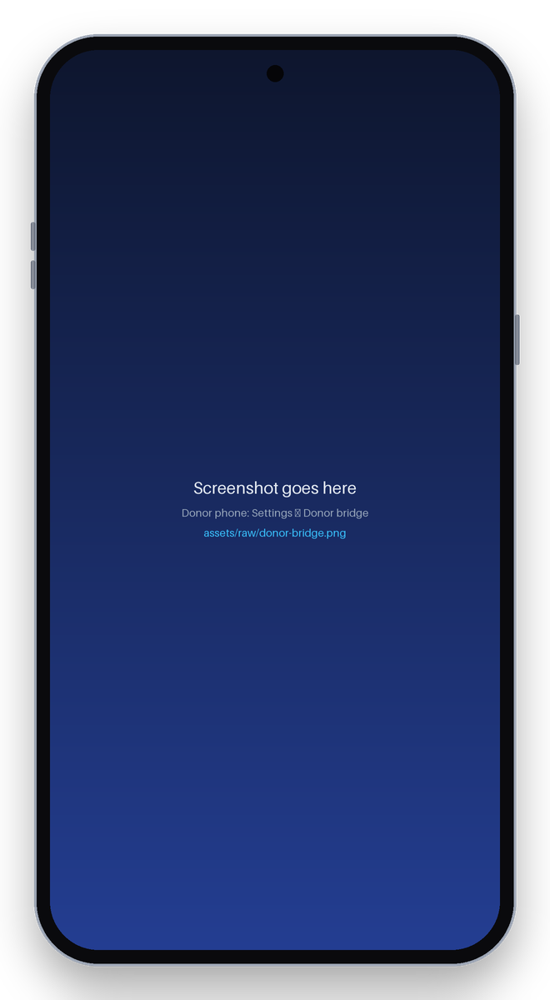
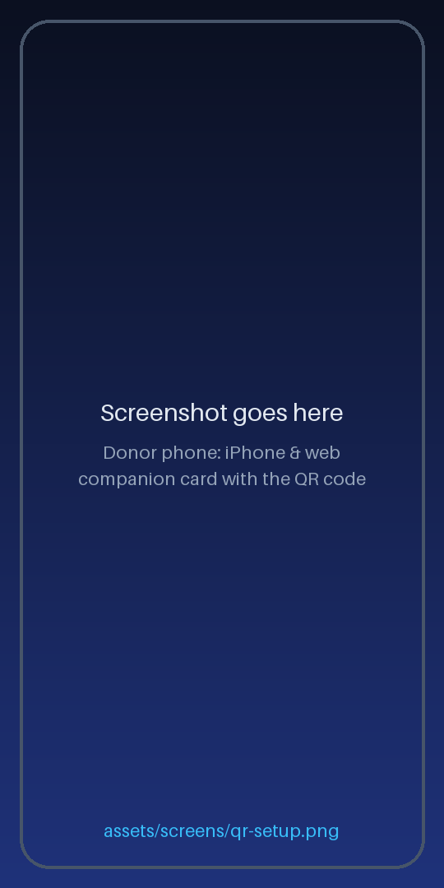
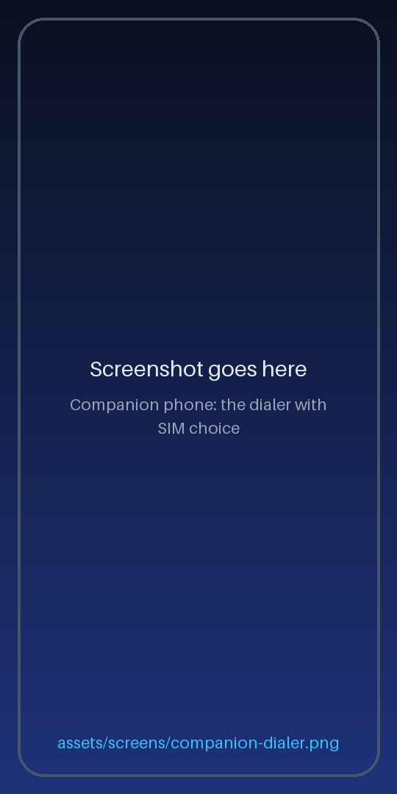
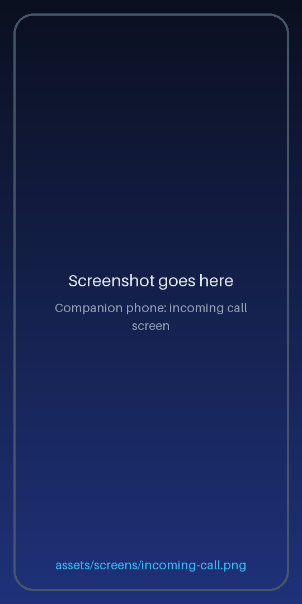
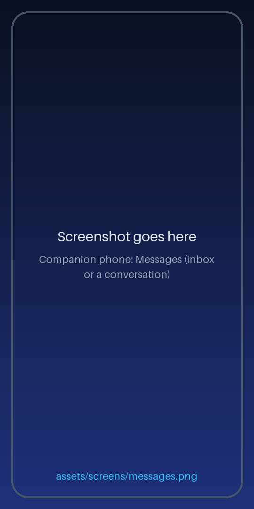

-->

---

## 🚀 Get started in 5 minutes

1. **Get the app.** The APK is sent to you personally: [message us on WhatsApp](https://wa.me/923017898347). Then install it on both Android phones (Android 14 or newer).
2. **Sign in** with your PhoneBridge account and pick the role: *Donor* on the phone with the SIMs, *Companion* on the other one.
3. **On the donor**: follow the setup guide, then start the bridge.
4. **On the companion**: add the donor in *Settings → Donors* (it's listed when both are on the same Wi-Fi), then press **Start**.
5. **For iPhone or a computer** *(optional)*: on the donor, switch on *iPhone & web companion* and scan the QR code.

<b>Step 3 in detail: setting up the donor</b>

 

- Allow the permissions PhoneBridge asks for and make it the default phone app when offered.
- Turn on **Developer options → Wireless debugging** and follow the on-screen pairing prompt. This is a one-time step, and PhoneBridge restarts its helper by itself afterwards.
- Keep the donor charged and on Wi-Fi.

<b>The web companion on iPhone, step by step</b>

 

1. On the donor open *Settings → iPhone & web companion* and switch it on.
2. Scan the QR code with the iPhone camera and open the link.
3. The first time on a device, install the donor's certificate from the sign-in page (*First time on this device?*).
4. Sign in with the same account, then **Share → Add to Home Screen**.
5. Open it from the Home Screen and turn on call alerts.

---

## ❓ FAQ

<b>Does my audio or data go through a cloud?</b>

 

No. Calls, texts and USSD travel between your devices over your own Wi-Fi, hotspot or Tailscale. The account service only checks that you are allowed to use the app.

<b>Can two phones use the same donor at once?</b>

 

One companion uses a donor at a time. A second one is told who is connected and can press **Take over**; the first one is told who took its place.

<b>Do I need an app on my iPhone?</b>

 

No. The donor serves a web companion, so Safari is enough. Add it to the Home Screen for call alerts.

<b>Does it work without internet on the donor?</b>

 

Yes, for a while. The donor keeps working on your local network until its licence runs out, and the web sign-in works offline once you have signed in online before.

<b>How do I get an account?</b>

 

Accounts are invitation-only. [Message us on WhatsApp](https://wa.me/923017898347) or [email us](mailto:nomanshabbir.official@gmail.com) and say what you'd like to use PhoneBridge for.

<b>Is the source code available?</b>

 

No. This repository only hosts this page.

---

### 💬 Get the app, updates and help

The app is sent personally: message us on WhatsApp or email. New versions and news are posted in the Telegram channel; questions and help in the Telegram chat.

© 2026 Noman (NoOneDev). All rights reserved. This repository hosts documentation only; the source code is not published.

